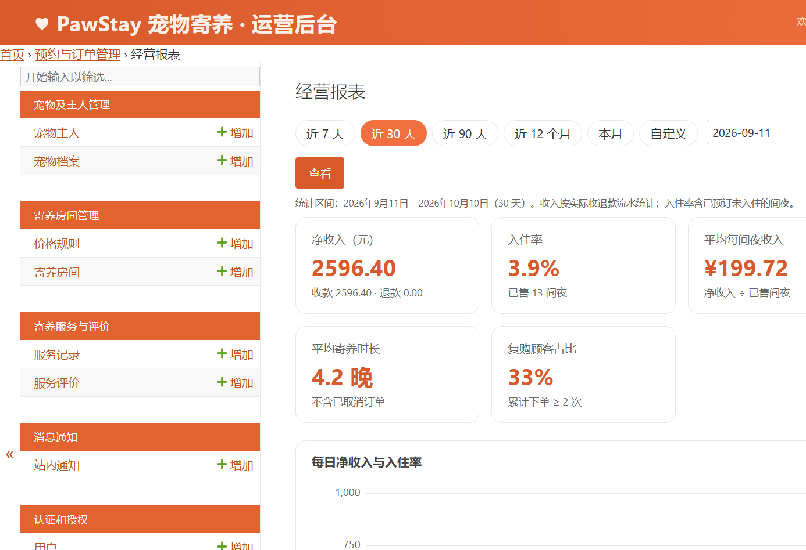
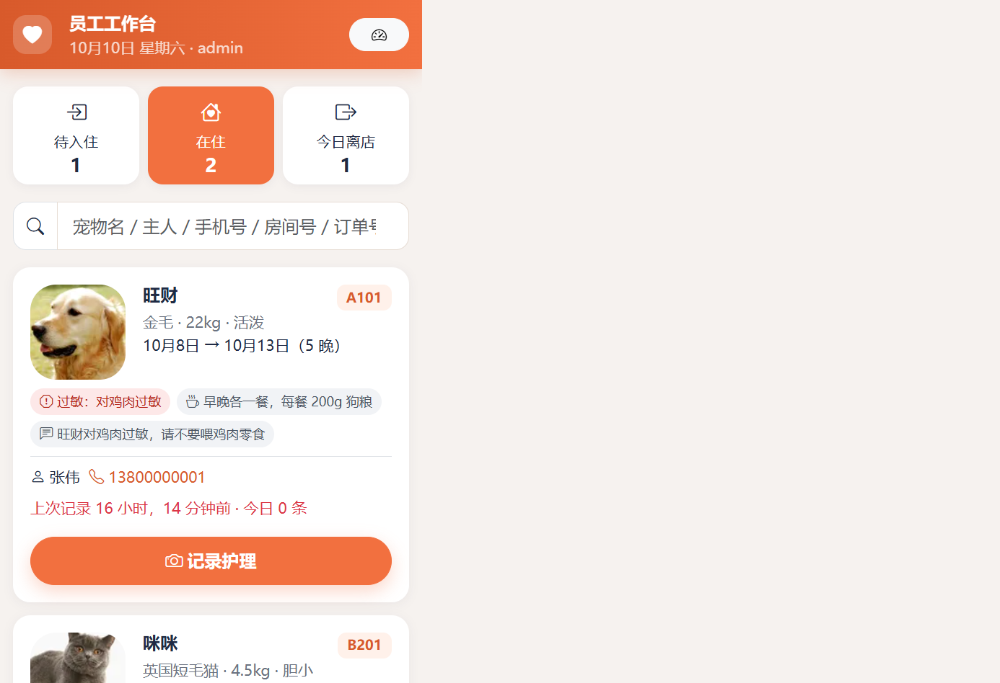

# PawStay 宠物寄养

面向宠物寄养门店的一站式 Web 应用：主人在官网查房、在线预约与支付、随时查看护理动态；门店在运营后台管理房间、订单、护理记录与收退款。


| 房间查询与报价 | 订单护理动态 | 运营看板 |
| --- | --- | --- |
|  |  |  |

| 经营报表 | 员工手机工作台 |
| --- | --- |
|  |  |

## 功能一览

**顾客端（官网）**

- 房间浏览：按宠物类型、房型、日期实时查询空房，自动给出逐晚明细报价（节假日加价、连住折扣）
- 账号：手机号 + 短信验证码注册、短信 / 邮件找回密码；连续输错密码先要求图形验证码，5 次锁定 15 分钟
- 我的宠物：建档（照片、体重、性格、饮食、过敏、疫苗与驱虫有效期）；照片上传自动压缩、纠正方向、去除 EXIF 定位
- 在线预约：中文日历区间选择（入住 / 离店联动、显示晚数），费用明细随房间和日期实时刷新；自动校验宠物类型、体型、性格与疫苗；满房可登记候补；支持优惠码与积分抵扣
- 会员积分：支付成功按实付金额累计积分，可在下单时按规则抵现并实时试算；会员中心查看等级、积分流水与可用券；离店发复购券、好评发感谢券
- 多门店：官网与后台按门店切换；房间、订单、房态日历与报表按当前门店隔离；员工可绑定 StaffStore 权限
- 电子收据：支付后可开具 PDF 收据（官网与 API）
- 开放 API：`/api/v1/` 房态、报价、预约、订单、护理、候补、员工操作、发票（见 [docs/API.md](docs/API.md)）
- 在线支付：微信 / 支付宝收银台（沙箱模拟扫码入账，或配置商户密钥走真实渠道回调）；微信 / 支付宝原路退款，失败自动标 RETRY- 并由调度任务重试；超时未支付自动取消并释放房间
- 自助改期：入住日前可换房 / 改日期，多退少补（差价自动原路退款或进入“待补差价”）
- 取消规则：入住日前免费取消全额退款；入住当天及之后扣首晚房费作违约金，取消弹窗预先展示退款金额
- 订单进度：步骤条 + 护理时间线（喂食、遛弯、洗护、健康状况与照片，照片灯箱浏览）
- 评价与站内通知：离店后评分评价；支付、入住、改期、护理动态、健康异常、候补有房即时通知

**员工手机工作台（`/staff/`）**

- 今日到店 / 在住 / 今日离店三栏，按宠物名、主人、手机号搜索
- 一键办理入住、离店（提前离店自动按实住晚数退款），现场收取现金 / 刷卡尾款
- 快速护理记录：大按钮选择进食与健康状况、常用短语一键填入、直接调用手机相机拍照

**运营后台（`/admin/`）**

- 运营看板：今日入住 / 离店、在住率、本月净收入、待收款、候补、评分与待回复评价，常用功能快捷入口
- 经营报表：收入 / 退款 / 净收入、入住率、平均每间夜收入、取消率、平均寄养时长、复购率；每日（超过 62 天按月）收入与入住率趋势图；房型、渠道、支付方式分析；Excel（日结摘要 + 明细）与 CSV 导出
- 房态日历：房间 × 日期占用网格；点击空格直接开单，点击占用订单进入改期
- 订单：办理入住、离店、取消（可选是否免收违约金）、门店收款、后台改期自动结算差价，可用房间查询
- 房间与价格：按门店管理房间展示信息与照片、维护停用、节假日价格规则
- 护理记录、收退款流水、候补队列、评价回复、站内通知、积分流水与优惠券
- 安全：后台与工作台强制 TOTP 二次验证（生产默认开启，兼容腾讯身份验证器、Microsoft / Google Authenticator 等），后台登录同样有限流与验证码
- 角色：预置“前台”“护理师”权限组

## 快速开始

依赖：Python 3.13、[uv](https://docs.astral.sh/uv/)、GNU Make、MySQL 8+（默认连接 `root@127.0.0.1:3306` 空密码，可在 `.env` 中修改）。

```bash
make seed   # 安装依赖、建库、迁移、写入演示数据
make run    # http://127.0.0.1:8000/
make test   # 全部单元测试
make help   # 全部命令
```

演示账号：

| 角色 | 入口 | 账号 / 密码 |
| --- | --- | --- |
| 管理员 | `/admin/`、`/staff/` | `admin` / `admin123` |
| 顾客 | `/account/login/` | `13800000001` / `pawstay123` |

演示数据按当天日期生成，`make reset-demo` 可随时清空重建。开发环境短信验证码不真实发送，会打印在 `make run` 的控制台日志里。

## 生产部署

```bash
cp .env.example .env   # 填写 DJANGO_SECRET_KEY、域名、MySQL 密码、SMTP、短信等
make docker-up         # MySQL + Gunicorn + 定时任务 + 自动备份 + Nginx
make docker-seed       # 可选：写入演示数据
```

- `web`：Gunicorn，启动时自动迁移；`/healthz` 用于健康检查
- `scheduler`：每 5 分钟执行 `expire_orders`（取消超时订单、处理候补、退款重试）
- 上线验收：`make launch-accept` 与 [docs/LAUNCH.md](docs/LAUNCH.md)
- `backup`：每天 `BACKUP_AT` 导出数据库与上传文件到 `./backups/`，保留 `BACKUP_KEEP_DAYS` 天；`make docker-backup` 立即备份
- `nginx`：反向代理与上传文件；HTTPS 证书建议在前置负载均衡或 Nginx 上配置
- 国内服务器构建镜像时在 `.env` 设置 `APT_MIRROR=mirrors.aliyun.com`
- 上线前执行 `make deploy-check`（Django 部署安全检查，含短信、二次验证配置检查）

主要配置项见 [`.env.example`](.env.example)：品牌与门店信息、连住折扣、违约金晚数、提前离店退款、最长寄养天数、是否强制疫苗、支付沙箱开关、支付超时、SMTP 邮件、阿里云短信、后台二次验证、500 错误告警邮箱（`DJANGO_ADMINS`）等。

持续集成：`.github/workflows/ci.yml` 在每次推送时用 MySQL 8.4 运行 ruff、系统检查、迁移完整性、部署安全检查与全部测试，并构建生产镜像做冒烟测试。

恢复备份：

```bash
gunzip < backups/db-YYYYMMDD-HHMMSS.sql.gz | docker compose exec -T db sh -c 'mysql -uroot -p"$MYSQL_ROOT_PASSWORD"'
docker compose run --rm -v "$PWD/backups:/backups" --entrypoint tar web -xzf /backups/media-YYYYMMDD-HHMMSS.tar.gz -C /data
```

## 项目结构

```
apps/
  pets/           宠物主人与宠物档案
  rooms/          房间、价格规则、报价计算
  bookings/       订单、收退款、改期与违约金、候补、可用房间校验、经营报表、房态日历、定时任务
  care/           护理记录与评价
  notifications/  站内通知（可选同步业务短信）
  payments/       微信 / 支付宝 / 沙箱收银台与异步入账
  security/       图形验证码、短信验证码、登录限流、TOTP 二次验证
  staff/          员工手机工作台（可安装为 PWA）
  web/            官网与会员中心
  images.py       上传图片压缩与缩略图
config/           Django 配置
templates/        页面模板（含后台定制）
static/           样式、图标、图片
deploy/           Nginx 配置、容器入口与备份脚本
docs/             说明文档与截图
```

详细说明见 `docs/`：项目概述、功能说明、数据库设计、开发与运行。

## 图片版权

站内图片来自 Wikimedia Commons，均为 CC0 / 公有领域 / CC BY / CC BY-SA 授权，作者与许可证见站点 `/pages/credits/` 页面（数据来自 `static/img/stock/credits.json`）。
