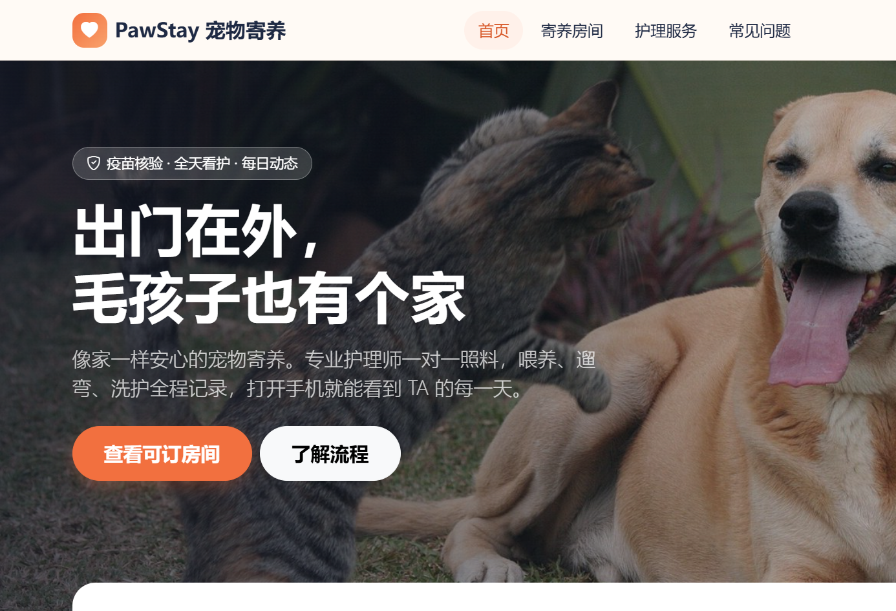
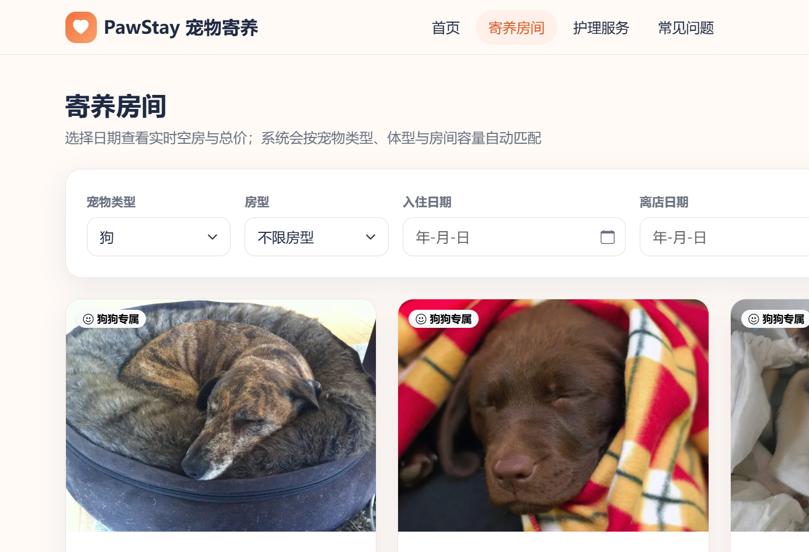
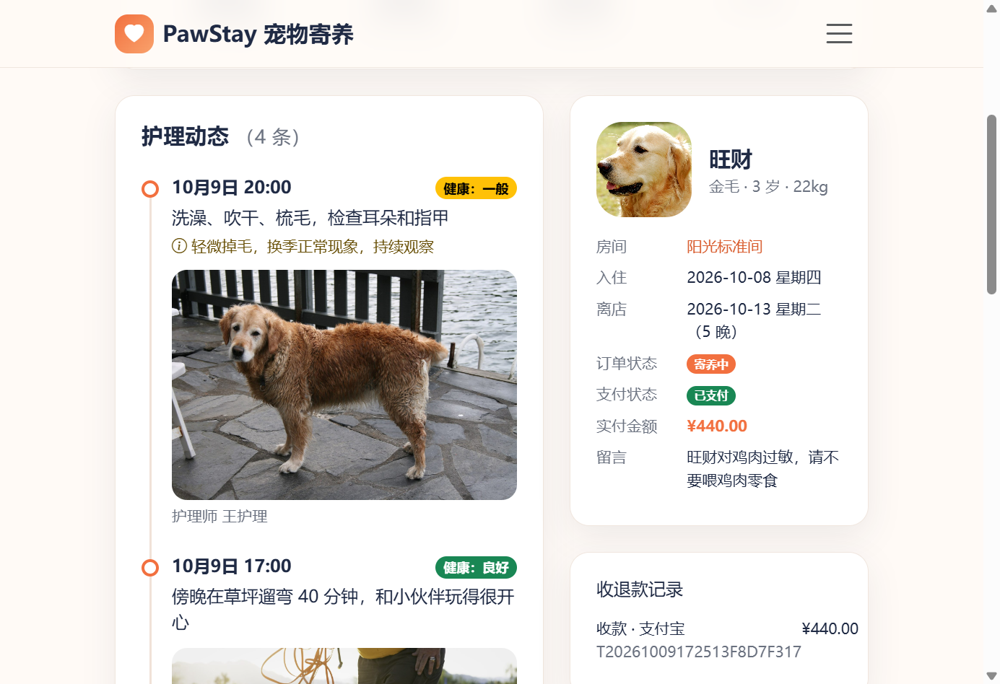
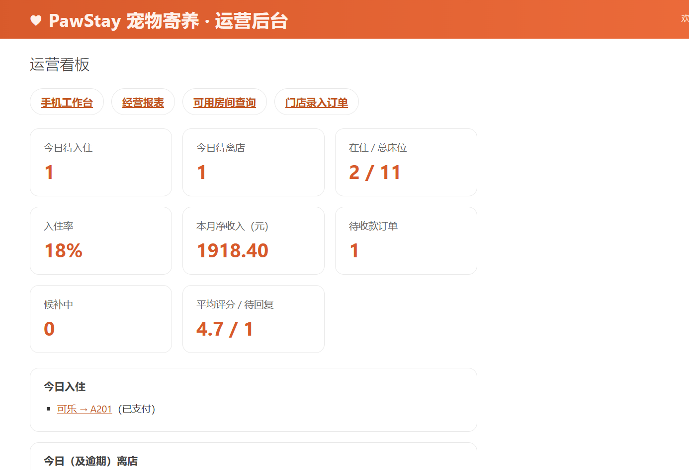

# PawStay 宠物寄养

课程精简版双端应用：官网可注册/登录并选择**顾客**或**门店**身份；顾客完成预约与评价，门店进入 `/store/` 后台（原 Admin）按四模块日常操作。支付为沙箱「一键已付」。



| 房间查询 | 订单与护理 | 门店后台 |
| --- | --- | --- |
|  |  |  |

## 课程四模块

| 模块 | 顾客端 | 门店后台 `/store/` |
| --- | --- | --- |
| 顾客宠物 | 个人信息 / 宠物登记 | 查询主人与宠物档案、历史寄养 |
| 房间 | 房间查询、选定下单 | 增删改查、改价、空闲/清洁/维护 |
| 订单 | 寄养记录、支付、状态 | 订单状态查询、收款、入住离店 |
| 服务与评价 | 护理进度、服务评价 | 日常服务反馈更新、评价回复 |

## 快速开始

依赖：Python 3.13、[uv](https://docs.astral.sh/uv/)、GNU Make、MySQL 8+。

```bash
make seed   # 安装依赖、建库、迁移、写入演示数据
make run    # http://127.0.0.1:8000/
make test   # 全部单元测试
make help   # 全部命令
```

演示账号：

| 角色 | 入口 | 账号 / 密码 |
| --- | --- | --- |
| 门店管理员 | 登录选「门店」→ `/store/` | `admin` / `admin123` |
| 门店前台 | 登录选「门店」 | `13900000001` / `pawstay123` |
| 门店护理 | 登录选「门店」 | `13900000002` / `pawstay123` |
| 顾客 | 登录选「顾客」 | `13800000001` / `pawstay123` |

本地运行说明见 [docs/LAUNCH.md](docs/LAUNCH.md)。

## 项目结构

```
apps/
  pets/           主人与宠物档案
  rooms/          房间与按晚报价
  bookings/       订单与收退款流水
  care/           护理记录与评价
  payments/       沙箱一键支付
  stores/         门店（单店）
  web/            官网与个人中心
  security/       账号相关辅助（课程版注册为手机号+密码）
  notifications/  遗留 app（未接入业务）
config/           Django 配置
templates/        页面模板
static/           样式、图标、图片
docs/             说明文档与截图
```
